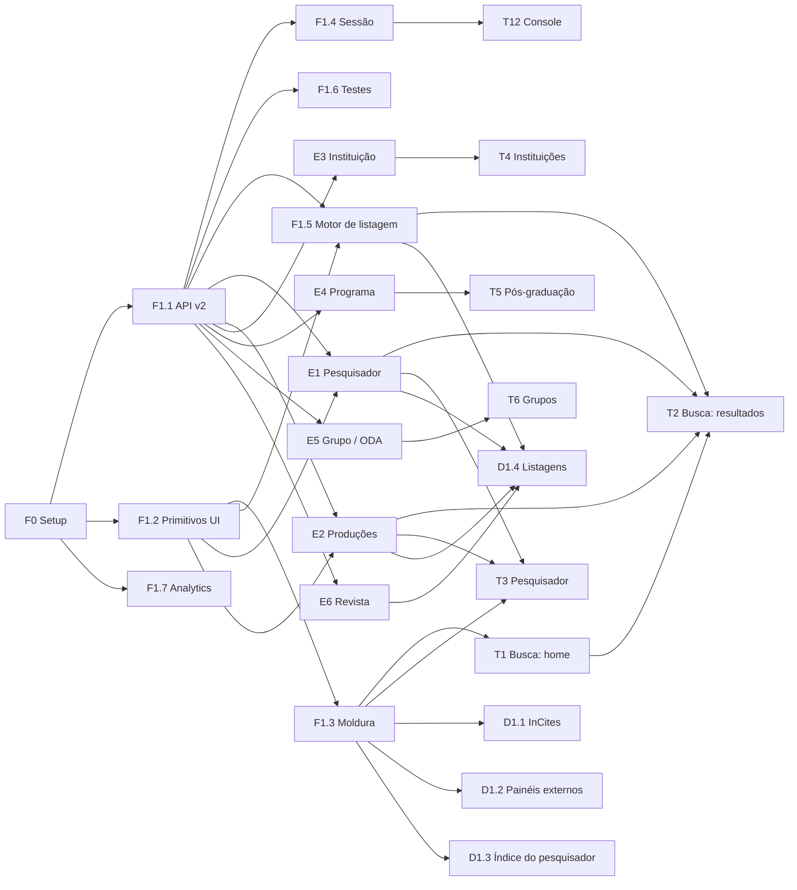

# Roadmap do novo front

Atualizado em 2026-11-20. Cada tarefa tem um ID, as dependências e um critério de "pronto". Escolha uma tarefa **a fazer** cujas dependências estejam **feitas**; o fluxo de trabalho está em [README.md](README.md).

**Status possíveis:** a fazer · em andamento · em revisão · feito · bloqueada (dependência externa).

## Visão geral

| Fase         | O que entrega                                                                | Pode começar                                          |
| ------------ | ---------------------------------------------------------------------------- | ----------------------------------------------------- |
| 0. Setup     | Projeto limpo, tooling, kit no Tailwind 4, este plano                        | feito                                                 |
| 1. Fundação  | Cliente da API, primitivos de UI, moldura, sessão, motor de listagem, testes | agora, em paralelo                                    |
| 2. Entidades | Modelo, queries e componentes de cada entidade                               | após F1.1 e F1.2                                      |
| 3. Telas     | Telas pelos templates do kit                                                 | conforme as entidades ficam prontas                   |
| 4. Virada    | Paridade, ambiente de produção, merge na `main`                              | quando a fase 3 fechar, junto com a virada do backend |

## Quadro de tarefas

| ID    | Tarefa                                            | Depende de       | Bloqueio externo                                            | Status                | Responsável    |
| ----- | ------------------------------------------------- | ---------------- | ----------------------------------------------------------- | --------------------- | -------------- |
| F0    | Setup inicial                                     | —                | —                                                           | feito                 | —              |
| F1.1  | Cliente e tipos da API v2                         | F0               | —                                                           | feito                 |                |
| F1.2  | Primitivos do kit e `design-tokens.ts`            | F0               | —                                                           | feito                 |                |
| F1.3  | Moldura e navegação                               | F1.2             | —                                                           | feito                 |                |
| F1.4  | Sessão e autenticação                             | F1.1             | —                                                           | feito                 |                |
| F1.5  | Motor de listagem                                 | F1.1, F1.2       | —                                                           | feito                 |                |
| F1.6  | Infraestrutura de testes (MSW)                    | F1.1             | —                                                           | feito                 |                |
| F1.7  | Analytics (GA4)                                   | F0               | —                                                           | feito                 |                |
| K1    | Gerar tema e CSS do kit a partir de `tokens.json` | F0               | —                                                           | feito                 |                |
| E1    | Entidade pesquisador                              | F1.1, F1.2       | —                                                           | feito                 |                |
| E2    | Entidade produção (registro por tipo)             | F1.1, F1.2       | —                                                           | feito                 |                |
| E3    | Entidade instituição                              | F1.1, F1.2       | —                                                           | feito                 |                |
| E4    | Entidade programa de pós-graduação                | F1.1, F1.2       | —                                                           | feito                 |                |
| E5    | Entidade grupo de pesquisa (adaptador ODA)        | F1.1, F1.2       | —                                                           | feito                 |                |
| E6    | Entidade revista                                  | F1.1, F1.2       | —                                                           | feito                 |                |
| T1    | Busca: home e barra de busca                      | F1.3             | —                                                           | feito                 | t1-busca-home  |
| T2    | Busca: resultados                                 | T1, F1.5, E1, E2 | —                                                           | a fazer               |                |
| T3    | Perfil do pesquisador                             | F1.3, E1, E2     | —                                                           | feito                 |                |
| T4    | Instituições (lista e detalhe)                    | F1.3, F1.5, E3   | —                                                           | feito                 | t4-instit      |
| T5    | Pós-graduação (landing, lista e detalhe)          | F1.3, F1.5, E4   | —                                                           | feito                 | t5-pos-grad    |
| T6    | Grupos de pesquisa                                | F1.3, F1.5, E5   | —                                                           | feito                 | t6-grupos      |
| T7    | Indicadores                                       | F1.3             | Indicadores além de produção ainda sem rota `/v2/metrics/*` | feito                 | t7-indicadores |
| T10   | MarIA                                             | F1.3, E1, E2     | Virada do backend                                           | bloqueada             |                |
| T12   | Console (a reimaginar)                            | F1.4, F1.2       | —                                                           | em revisão (proposta) | t12-prop       |
| D1.1  | InCites                                           | F1.3             | —                                                           | feito                 | d1-1-incites   |
| D1.2  | Painéis de dados externos                         | F1.3             | —                                                           | feito                 | d1-2-paineis   |
| D1.3  | Índice do pesquisador                             | F1.3, F1.2       | —                                                           | feito                 | d1-3-indice    |
| D1.4  | Listagens                                         | F1.5, E1, E2, E6 | —                                                           | a fazer               |                |
| V1–V5 | Virada (ver fase 4)                               | fase 3           | Virada do backend                                           | a fazer               |                |

## Fase 1: fundação

### F1.1 Cliente e tipos da API v2

- **Objetivo:** uma forma única e tipada de chamar a v2.
- **Toca em:** `src/api/`, `src/config/`.
- **Pronto quando:**
  - `npm run api:types` gera `src/api/generated/simcc-v2.d.ts` a partir de `/v2/openapi.json` (não do mesclado), e o arquivo está commitado;
  - `src/api/simcc.ts` exporta um cliente `openapi-fetch` com `baseUrl` de `env.simccApiUrl`;
  - um middleware converte o erro da v2 (`{ error: { code, message, details } }`) em `ApiError` (`status`, `code`, `message`, `details`);
  - existem helpers de tipo para os envelopes de lista e de detalhe (`{ data, meta }`);
  - testes unitários da normalização de erro.

### F1.2 Primitivos do kit e `design-tokens.ts`

- **Objetivo:** a base visual que todas as telas usam.
- **Toca em:** `src/shared/ui/`, `src/shared/lib/`, `components.json`.
- **Pronto quando:**
  - `components.json` do shadcn aponta para `@/shared/ui` e `@/shared/lib`;
  - primitivos adaptados ao kit (`design-kit/reference/components.md`): button, card (sem sombra), badge, input, tabs, accordion, checkbox, dialog, sheet, dropdown-menu, popover, select, separator, skeleton, tooltip, table, scroll-area, toggle-group, sonner;
  - componentes do kit: `PillLink`, `StatCard`, `SectionHeader`, `ResultToolbar` (sem "Baixar resultado", ver [ADR 0006](decisoes/0006-sem-exportacao-csv.md)), `LoadingBlock`, `EmptyState`;
  - `src/shared/lib/design-tokens.ts` com um mapeamento por dicionário (área, Qualis, tipo de produção, tipo de busca, orientação, status, bolsa), com testes;
  - uma vitrine dos primitivos numa rota só de desenvolvimento, para revisão visual.

### F1.3 Moldura e navegação

- **Objetivo:** topbar, sidebar e crumbbar da área pública (`DESIGN.md` §6.1).
- **Toca em:** `src/features/shell/`, `src/routes/` (rota de layout sem path), `src/routes/__root.tsx`.
- **Pronto quando:**
  - uma rota de layout envolve as telas públicas com a moldura;
  - o breadcrumb usa o nome legível de cada rota (`staticData.crumb`), e não o slug;
  - sidebar colapsável (preferência salva via `src/shared/lib/storage.ts`), sheet no mobile;
  - 404 e tela de erro definitivas no padrão do kit;
  - a home provisória da fase 0 é removida.

### F1.4 Sessão e autenticação

- **Objetivo:** login no IdP e rotas protegidas ([ADR 0008](decisoes/0008-autenticacao.md)).
- **Toca em:** `src/api/idp.ts`, `src/api/admin.ts`, `src/features/auth/`, `src/routes/auth.*`, `src/app/` (sessão no contexto do router).
- **Pronto quando:**
  - fluxo PKCE completo (login, callback, troca do code, logout via `end_session`), portado de `legado-v1:src/services/auth.ts`;
  - nenhum token em storage: access e refresh token só em memória; a renovação passa por uma fila única, porque o refresh token é rotacionado e reusá-lo revoga a sessão;
  - ao recarregar, a rota protegida retoma a sessão com `prompt=none`; com `login_required`, vai para o login; a rota de destino volta no `state`;
  - `is_admin` lido de `GET <admin>/me`, nunca do token; o campo `role` do token é ignorado;
  - `beforeLoad` protege o console: sem sessão, retoma ou faz login; sem `is_admin`, mostra "sem acesso";
  - `useSession()` expõe usuário e `is_admin`;
  - o cliente da API de admin normaliza `{ detail }` para `ApiError` e trata `401`, `403` e `502`/`504` como no ADR 0008;
  - o token só é enviado à API de admin.
- **Ambiente:** a `v3/develop` do `simcc-admin` ainda não está publicada. Use o `/me` simulado (MSW) ou a API de admin local.

### F1.5 Motor de listagem

- **Objetivo:** a mesma mecânica de busca, filtro, faceta, ordenação e paginação em todas as listas.
- **Toca em:** `src/shared/lib/search-params.ts`, `src/shared/ui/` (FacetPanel, Pagination, SortSelect).
- **Pronto quando:**
  - um schema zod de busca é usado tanto no `validateSearch` quanto na chamada à API, sem conversão manual por tela;
  - `FacetPanel` renderiza qualquer `FacetResult` da v2. A faceta `year` vira intervalo (`year_start`/`year_end`). O filtro de cada faceta vem do campo `param`;
  - paginação e ordenação mudam a URL;
  - testes do round-trip URL ↔ API.

### F1.6 Infraestrutura de testes

- **Toca em:** `src/test/`.
- **Pronto quando:** existem handlers MSW a partir dos exemplos do OpenAPI; `renderRoute()` monta uma rota real com router em memória e `QueryClient` de teste; há um teste de exemplo de tela.

### F1.7 Analytics (GA4)

- **Toca em:** `src/shared/lib/analytics.ts`, `src/app/`.
- **Pronto quando:** um `page_view` é enviado a cada navegação do router, só quando `VITE_GA_MEASUREMENT_ID` está definido; sem a variável, nenhum script do Google é carregado.

### K1 Tokens do kit gerados de `tokens.json`

- **Toca em:** `design-kit/tokens/`, `scripts/`.
- **Pronto quando:** um script gera `tailwind.css` e o bloco `:root` de `simcc.css` a partir de `tokens.json`, e a CI falha se os arquivos estiverem fora de sincronia.

## Fase 2: entidades

Cada entidade fica em `src/entities/<nome>/`, com:

- `model.ts`: tipos derivados dos gerados, mais rótulos e formatação;
- `queries.ts`: `queryOptions` com as keys `['<nome>', '<operação>', params]`;
- `ui/`: componentes de apresentação.

As entidades são independentes entre si e podem ser feitas em paralelo.

| ID  | Entidade                             | Componentes esperados                                                                                                | Observações                                                                                                                                                                                         |
| --- | ------------------------------------ | -------------------------------------------------------------------------------------------------------------------- | --------------------------------------------------------------------------------------------------------------------------------------------------------------------------------------------------- |
| E1  | Pesquisador (`researcher`)           | `ResearcherRef` (nome com link), `ResearcherAvatar`, `PersonCard`, cabeçalho de perfil                               | Usar `id` e `image_url`; `include=education,experience,foment` no detalhe                                                                                                                           |
| E2  | Produção (`production`)              | Registro por tipo: cor, ícone, título, subtítulo, etiquetas, campos do detalhe. `ProductionCard`, `ProductionDetail` | Portar a ideia de `legado-v1:src/components/homepage/result-home-v2/production-registry.ts`. Tipos: article, book, book_chapter, software, patent, event, research_project, brand, guidance, report |
| E3  | Instituição (`institution`)          | `InstitutionRef`, `EntityCard`                                                                                       | Detalhe em `/v2/institution/{id}`, com contagens                                                                                                                                                    |
| E4  | Programa (`graduate-program`)        | `ProgramRef`, `EntityCard`, linhas de pesquisa                                                                       | Detalhe com linhas e instituição                                                                                                                                                                    |
| E5  | Grupo de pesquisa (`research-group`) | `GroupRef`, `EntityCard`                                                                                             | Cliente em `src/api/oda/` com schema zod; ver [ADR 0007](decisoes/0007-escopo-de-dados.md)                                                                                                          |
| E6  | Revista (`magazine`)                 | `MagazineRef` com Qualis e JCR                                                                                       | `/v2/magazine`; Qualis vem como enum + `qualis_status`                                                                                                                                              |

**Pronto quando**, para cada entidade: queries e componentes testados, e componentes visíveis na vitrine de desenvolvimento.

## Fase 3: telas

Templates de `design-kit/DESIGN.md` §6.2. As rotas novas propostas estão em [legado/inventario.md](legado/inventario.md); a tarefa confirma o path e atualiza o inventário.

| ID  | Tela                         | Template  | Notas                                                                                                                                                                                                                                                                                                                                                                                                                                                                                                                                                                       |
| --- | ---------------------------- | --------- | --------------------------------------------------------------------------------------------------------------------------------------------------------------------------------------------------------------------------------------------------------------------------------------------------------------------------------------------------------------------------------------------------------------------------------------------------------------------------------------------------------------------------------------------------------------------------- |
| T1  | Busca: home e barra de busca | A         | Feature `search`. Seletor de tipo, sugestões via `/v2/suggestion`                                                                                                                                                                                                                                                                                                                                                                                                                                                                                                           |
| T2  | Busca: resultados            | D         | Mesma feature `search`, depois da T1. Abas por tipo, facetas, KPIs, ranking. Abrir um pesquisador navega para a rota do perfil (overlay)                                                                                                                                                                                                                                                                                                                                                                                                                                    |
| T3  | Perfil do pesquisador        | E         | `/pesquisadores/$id`, abas de produção, nuvem de termos via `/v2/researcher/{id}/terms`, bolsas via `/v2/scholarship`                                                                                                                                                                                                                                                                                                                                                                                                                                                       |
| T4  | Instituições                 | C → E     | Lista e detalhe                                                                                                                                                                                                                                                                                                                                                                                                                                                                                                                                                             |
| T5  | Pós-graduação                | B → C/E   | Mapa Leaflet dos territórios. GeoJSON: `git show legado-v1:public/territorio_relacionado.json`                                                                                                                                                                                                                                                                                                                                                                                                                                                                              |
| T6  | Grupos de pesquisa           | C         | Dados da ODA                                                                                                                                                                                                                                                                                                                                                                                                                                                                                                                                                                |
| T7  | Indicadores                  | B         | Começa pelas séries de `/v2/metrics/production/{kind}`. Cada indicador que não for de produção precisa de rota nova no backend: listar quais e pedir                                                                                                                                                                                                                                                                                                                                                                                                                        |
| T10 | MarIA                        | D (chat)  | Bloqueada: virada do backend                                                                                                                                                                                                                                                                                                                                                                                                                                                                                                                                                |
| T12 | Console                      | a definir | **Reimaginar, não portar.** Proposta em [propostas/t12-console.md](propostas/t12-console.md), **aguardando aprovação antes da implementação na Onda 4** (decisão visual `--sc-*` vs `sm-*`, confirmação do OpenAPI de `/academic/*`/`/admins`/`/etl/*`, métricas GA4 no console e troca da chave do ETL). O legado (`legado-v1:src/components/console/`) serviu só para levantar o que existia. Um só papel: admin faz tudo. Todos os dados vêm da API de admin (`/academic/*`, `/admins`, `/etl/*`), inclusive as ações do ETL ([ADR 0008](decisoes/0008-autenticacao.md)) |

### Telas complementares (D1)

Telas do legado que entram no escopo. São independentes entre si.

| ID   | Tela                      | Template | Notas                                                                                                                                                                                                                                                                                                                                                                                           |
| ---- | ------------------------- | -------- | ----------------------------------------------------------------------------------------------------------------------------------------------------------------------------------------------------------------------------------------------------------------------------------------------------------------------------------------------------------------------------------------------- |
| D1.1 | InCites                   | F        | Cards com links para os painéis InCites (`simcc.uesc.br/incite/*`). Conteúdo em `legado-v1:src/components/incites/content-incites.tsx`                                                                                                                                                                                                                                                          |
| D1.2 | Painéis de dados externos | F        | Cards com links para fontes externas (CNPq, CAPES, OpenAlex, Lattes, INPI, Scopus…). Conteúdo em `legado-v1:src/components/homepage/paines-dados-externos.tsx`; revisar links quebrados ou que exigem login institucional                                                                                                                                                                       |
| D1.3 | Índice do pesquisador     | F        | Explica os níveis do índice (tempo de doutorado, produção, orientação). Conteúdo em `legado-v1:src/components/indice-pesquisador/`. A cor de cada nível vai para `design-tokens.ts`                                                                                                                                                                                                             |
| D1.4 | Listagens                 | C        | Uma aba por catálogo da v2: pesquisadores, bolsistas (`/v2/scholarship`), produções por tipo e revistas (`/v2/magazine`), com o motor da F1.5 e os componentes das entidades. Avaliar com a T2 se vira a busca sem termo, para não haver duas telas iguais. "Texto em revista" e "trabalho em evento" não existem na v2: pedir ao backend ou descontinuar. Técnicos (UFMG) estão descontinuados |

**Pronto quando**, para cada tela: segue o template e as regras do kit; funciona em 1440px e 375px, nos temas claro e escuro; todo estado navegável está na URL; há teste com a API simulada; o inventário está atualizado.

**Fora do escopo** (decisão de 2026-11-20): páginas de documento (termos de uso, política de privacidade, API, informações, dicionário de cores), vídeos, páginas autônomas (sobre, observatório, TV), provimento de cargo e produções recentes. Ver [legado/inventario.md](legado/inventario.md).

## Fase 4: virada

| ID  | Tarefa                    | Pronto quando                                                                                                                                                                                                                                                                                                                                                                     |
| --- | ------------------------- | --------------------------------------------------------------------------------------------------------------------------------------------------------------------------------------------------------------------------------------------------------------------------------------------------------------------------------------------------------------------------------- |
| V1  | Paridade                  | Toda linha de [legado/inventario.md](legado/inventario.md) está como "feita" ou "descontinuada"                                                                                                                                                                                                                                                                                   |
| V2  | Redirects                 | URLs antigas relevantes (`/researcher`, `/instituicao/:acronym`, `/resultados*`, `/resultados-ia`…) redirecionam para as novas                                                                                                                                                                                                                                                    |
| V3  | Ambiente de produção      | `.env` do servidor com os nomes novos (`.env.example`); `deploy-obs.yaml` sem o `--build-arg VITE_URL_GERAL2`; `compose.yaml` revisado (hoje aponta para uma porta de um estágio `FROM scratch`)                                                                                                                                                                                  |
| V4  | Coordenação com o backend | A branch `feat/v2-contrato` do backend e a remoção dos campos `deprecated` publicadas junto com o merge `develop` → `main` do front. As mudanças que quebram o front atual estão em `simcc-back:docs/changelog-v2.md`. Também em produção: a `v3/develop` do `simcc-admin` (com `ADMIN_BOOTSTRAP_SUBS` definido) e as mudanças do IdP ([ADR 0008](decisoes/0008-autenticacao.md)) |
| V5  | Desligamento              | Lista de rotas v1 que o front deixou de usar entregue ao backend                                                                                                                                                                                                                                                                                                                  |

## Estado do backend

Fases definidas em [backend/resposta-backend-v2.md](backend/resposta-backend-v2.md) §8. O changelog do contrato fica no backend, em `docs/changelog-v2.md`, e o OpenAPI versionado em `docs/openapi-v2.json`.

| Fase do backend | Entrega                                                                                                                              | Status                              |
| --------------- | ------------------------------------------------------------------------------------------------------------------------------------ | ----------------------------------- |
| 0               | Envelope de erro, `{ data, meta }` nos detalhes, `param` nas facetas, `id` e `image_url`, `sort_by`/`sort_order`, `data_as_of`       | pronta na branch `feat/v2-contrato` |
| 1               | Detalhe completo do pesquisador, detalhe de instituição e programa, `brand`, `guidance` e `report`, `highlights`, enum único de tipo | pronta na branch `feat/v2-contrato` |
| 2               | Exemplos no OpenAPI, revista, bolsas, termos, Qualis e JCR tipados, `/v2/metrics/production/{kind}`                                  | pronta na branch `feat/v2-contrato` |
| Virada          | Remoção dos campos `deprecated`, publicação na `main` junto com o front (V4); MarIA                                                  | pendente                            |

A branch `feat/v2-contrato` ainda não foi publicada. Para desenvolver contra ela, rode o backend localmente (`http://localhost:8088`) e aponte `VITE_SIMCC_API_URL=http://localhost:8088/` no seu `.env`. Os tipos (`npm run api:types`) saem do mesmo endereço.

**Fora do backend:** o IdP (`prompt=none`, `aud`, rotação do refresh token, `end_session`) e a API de admin (`/me` com `is_admin`, `/admins`, `/etl/*`, na branch `v3/develop`) já entregaram o que o front pediu; ver [ADR 0008](decisoes/0008-autenticacao.md). Falta a troca da chave do ETL que vazou no legado, que é urgente.
